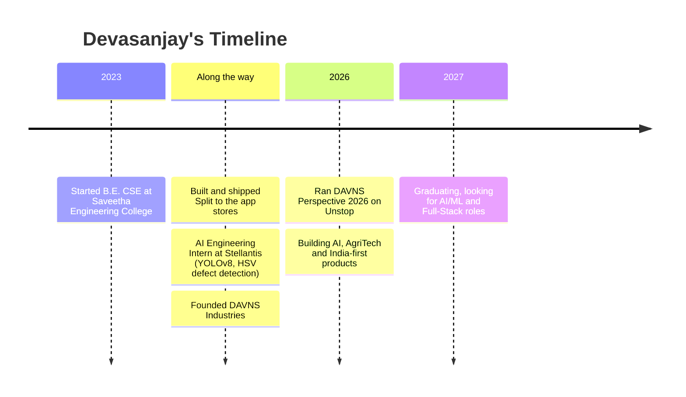

<!--
  PROFILE README for github.com/DEVASANJAY001
  Setup: create a PUBLIC repo named exactly "DEVASANJAY001", add this file as README.md in the root.
  Search for "TODO" to find the few links only you can fill in.
-->

<!-- ╔══════════════════════ HEADER ══════════════════════╗ -->

<div align="center">


<a href="https://github.com/DEVASANJAY001">
  
</a>

<br/><br/>


<br/>

[](https://YOUR-PORTFOLIO-URL)
[](https://www.linkedin.com/in/YOUR-LINKEDIN-ID)
[](mailto:YOUR-EMAIL@example.com)
[](https://YOUR-DAVNS-WEBSITE)

<!-- TODO: replace the four YOUR-... links above -->

</div>

<br/>

<!-- ╔══════════════════════ SNAPSHOT ══════════════════════╗ -->

<div align="center">

| 🎓 Education | 🏢 Founder | 🚗 Experience | 📱 Shipped | 📍 Base |
|:---:|:---:|:---:|:---:|:---:|
| **B.E. CSE**<br/>Saveetha Engineering College<br/>2023 – 2027 | **DAVNS Industries**<br/>Products & programs | **AI Engineering Intern**<br/>Stellantis, Thiruvallur | **Split**<br/>Live on app stores | **Chennai**<br/>India |

</div>

---

## 👋 &nbsp;About Me

<table>
<tr>
<td width="60%" valign="top">

I'm **Devasanjay**, a final-year Computer Science student and the founder of **DAVNS Industries**. I build projects that blend **intelligence, technology and real-world impact**: a mobile app that real people download, a computer-vision model that catches defects on a factory line, or a platform designed around how India actually uses the internet.

- 🚀 **Founder** at DAVNS Industries, shipping products and running programs
- 📱 Built and deployed **Split**, an expense-splitting app on the app stores
- 🏭 **AI Engineering Intern at Stellantis** (automotive quality and vision systems)
- 🧠 Working across **LLM APIs, RAG, NLP and computer vision**
- ☁️ Exploring **AWS**, cloud deployment and real-world application development
- 🧮 Passionate about **algorithms, search strategies and system design**
- 🇮🇳 Drawn to **India-focused problems** and underserved niches
- 🎯 Open to **AI/ML, Full-Stack and Computer Vision** roles in Chennai (graduating 2027)

</td>
<td width="40%" valign="top">

```text
┌────────────────────────────────┐
│  🧑‍💻  DEVASANJAY N              │
├────────────────────────────────┤
│  Role    Founder · Developer   │
│  Org     DAVNS Industries      │
│  Focus   Full-Stack · AI · CV  │
│  Cloud   AWS (learning)        │
│  Edu     B.E. CSE (2023-27)    │
│  Base    Chennai, India        │
│  Status  Building 🔨           │
│  Roles   Open to work ✅       │
└────────────────────────────────┘
```

</td>
</tr>
</table>

---

## 🎯 &nbsp;What I Do

<div align="center">

| 📱 Mobile & Web | 🤖 AI & LLM Systems | 👁️ Computer Vision | ☁️ Cloud & Algorithms |
|:---:|:---:|:---:|:---:|
| React, Next.js and React Native apps with Firebase and Node backends | LLM APIs, RAG, NLP, prompt engineering and text-processing workflows | YOLOv8, OpenCV and HSV-based defect detection | AWS (S3, EC2, private cloud) plus search and planning algorithms |

</div>

### 🔬 Focus Areas

<div align="center">

| 🧾 Spec & QA Matrix | 🐞 Defect Detection | 📄 Text Workflows | 🌐 Automation |
|:---:|:---:|:---:|:---:|
| Requirements validation and QA coverage systems | AI inspection for industrial and automotive quality | Text splitting, chunking, extraction and data cleaning | Web scraping, data extraction and structured insights |

</div>

---

## 🧩 &nbsp;Tech Stack

<div align="center">

| | |
|:--|:--|
| **Languages** |  |
| **Frontend & Mobile** |  |
| **Backend & Databases** |  |
| **AI / ML / CV** |  |
| **Cloud & DevOps** |  |
| **Tools** |  |

<br/>


</div>

---

## 🚀 &nbsp;Flagship Work

<table>
<tr>
<td width="50%" valign="top">

#### 💸 Split
`Mobile App` · **Live on the app stores**

Expense-splitting app built, deployed and maintained end to end.


[🔗 View on store](https://YOUR-SPLIT-APP-LINK) <!-- TODO -->

</td>
<td width="50%" valign="top">

#### 🏭 Automotive Defect Detection
`Computer Vision` · **Stellantis, Thiruvallur Plant**

AI inspection with **YOLOv8** and **HSV colour-space defect detection** for automotive quality use cases.


</td>
</tr>
<tr>
<td width="50%" valign="top">

#### 🌾 AI Fertilizer Recommendation Engine
`AgriTech ML` · **Tamil Nadu hackathon · In progress**

Designed to recommend optimal NPK ratios per district, crop and season from soil-health, crop-yield and weather data, modelled with **XGBoost**.


</td>
<td width="50%" valign="top">

#### 🗣️ Adda
`Product Spec` · **Reddit-alternative for Indian users**

200+ screen sitemap, mobile wireframes, AWS backend architecture, UPI-native monetisation and a localisation strategy.


</td>
</tr>
<tr>
<td width="50%" valign="top">

#### 🧠 DAVNS Perspective 2026
`Community` · **"The Thinking Challenge"**

Six-day college aptitude competition on Unstop (1–6 September 2026) with 180 quizzes, organised by DAVNS Industries.


</td>
<td width="50%" valign="top">

#### 🔐 Encrypted Messaging Research
`Architecture` · **Signal Protocol + Firebase**

Explored an end-to-end encrypted messaging architecture combining the Signal Protocol with Firebase.


</td>
</tr>
</table>

---

## 📦 &nbsp;Repositories

### 🧠 AI / ML / GenAI

| Repository | What it is |
|:--|:--|
| 🩺 [**DermAI-Scanner**](https://github.com/DEVASANJAY001/DermAI-Scanner) | AI-powered skin lesion analysis |
| 📄 [**AI-Resume-Analyzer**](https://github.com/DEVASANJAY001/AI-Resume-Analyzer) | AI-based resume evaluation system |
| 🎤 [**Ai-interview**](https://github.com/DEVASANJAY001/Ai-interview) | AI-driven interview support system |
| 🛢️ [**Engine-oil-leak-detection**](https://github.com/DEVASANJAY001/Engine-oil-leak-detection) | Applied AI and data-driven problem solving |
| ⭐ [**A-STAR**](https://github.com/DEVASANJAY001/A-STAR) | Pathfinding and optimisation algorithm |
| 🗺️ [**CLASSICAL-PLANNING**](https://github.com/DEVASANJAY001/CLASSICAL-PLANNING) | AI planning and search-based problem solving |

### 🌐 Web & Apps

| Repository | What it is |
|:--|:--|
| 🌐 [**Devasanjay-s-portfolio**](https://github.com/DEVASANJAY001/Devasanjay-s-portfolio) | Personal portfolio |
| 🎨 [**Bootstrap-5-portfolio-template**](https://github.com/DEVASANJAY001/Bootstrap-5-portfolio-template) | Responsive portfolio template |
| ♟️ [**chessmate-pro**](https://github.com/DEVASANJAY001/chessmate-pro) | Web application project |
| 💬 [**chatteam**](https://github.com/DEVASANJAY001/chatteam) | Communication and teamwork app |
| 🎉 [**eventday**](https://github.com/DEVASANJAY001/eventday) | Event-focused app |
| 🧩 [**codebindtech**](https://github.com/DEVASANJAY001/codebindtech) | UI and web development project |

### ☁️ Cloud / AWS

| Repository | What it is |
|:--|:--|
| 🪣 [**Cloud-Storage-creation-S3-and-Launching-an-EC2-Instance-in-AWS**](https://github.com/DEVASANJAY001/Cloud-Storage-creation-S3-and-Launching-an-EC2-Instance-in-AWS) | S3 storage and EC2 instance launch |
| 🏗️ [**Deployment-and-configuration-of-a-Private-Cloud-in-AWS**](https://github.com/DEVASANJAY001/Deployment-and-configuration-of-a-Private-Cloud-in-AWS) | Private cloud deployment and configuration |
| 🔧 [**AWS-Account-Creation**](https://github.com/DEVASANJAY001/AWS-Account-Creation) | AWS account setup |
| ☁️ [**Cloud-account-set-up-and-services**](https://github.com/DEVASANJAY001/Cloud-account-set-up-and-services) | Cloud account setup and core services |

### 🧮 Data, Algorithms & Core CS

| Repository | What it is |
|:--|:--|
| 📊 [**algo**](https://github.com/DEVASANJAY001/algo) | Algorithm and logic-focused work |
| 🔎 [**Correlation_Regression**](https://github.com/DEVASANJAY001/Correlation_Regression) | Statistical and computational learning |
| 🔐 [**AES**](https://github.com/DEVASANJAY001/AES) | Cryptography learning project |
| 🧾 [**19CS404-DBMS-Lab-Manual**](https://github.com/DEVASANJAY001/19CS404-DBMS-Lab-Manual) | Database fundamentals |
| 📚 [**Advanced-C-Lab-Manual**](https://github.com/DEVASANJAY001/Advanced-C-Lab-Manual) | Systems and C programming concepts |
| 🛠️ [**19AI307_ODD-25-26-**](https://github.com/DEVASANJAY001/19AI307_ODD-25-26-) | Academic AI lab repository |
| 🎨 [**color**](https://github.com/DEVASANJAY001/color) · [**bigcolor**](https://github.com/DEVASANJAY001/bigcolor) | Design and colour experiments |

> 📂 **248 repositories** in total. Browse them all on the [Repositories tab](https://github.com/DEVASANJAY001?tab=repositories).

---

## 💼 &nbsp;Journey



<details>
<summary><b>📋 Experience &amp; Education (click to expand)</b></summary>
<br/>

| Role | Where | What I did |
|:--|:--|:--|
| 🚀 **Founder** | DAVNS Industries | Builds and ships products, runs programs such as DAVNS Perspective 2026 |
| 🧪 **AI Engineering Intern** | Stellantis, Thiruvallur Plant | Computer-vision and AI work for automotive quality systems (YOLOv8, HSV-based defect detection) |
| 🎓 **B.E. Computer Science & Engineering** | Saveetha Engineering College, Anna University | 2023 – 2027 |

</details>

---

## 🔭 &nbsp;Right Now

<div align="center">

| | |
|:--|:--|
| 🔨 **Building** | DAVNS Industries products, an AgriTech ML engine and the Adda platform |
| 📚 **Exploring** | RAG pipelines, LLM workflows, encrypted messaging, YOLO-based inspection, AWS deployment |
| 🌱 **Curious about** | Used-car verification in tier-2/3 cities, formalising domestic work, services for kirana stores |
| 🎯 **Looking for** | AI/ML Engineer · Full-Stack Developer · Computer Vision roles in Chennai |
| 💬 **Ask me about** | Shipping to the app stores, Firebase, YOLO + OpenCV, building a startup as a student |

</div>

---

## 📊 &nbsp;GitHub Analytics

<div align="center">

<table>
<tr>
<td align="center"></td>
<td align="center"></td>
</tr>
</table>


</div>

<!-- Optional contribution snake: add .github/workflows/snake.yml, run it once, then uncomment.

<div align="center">
  <picture>
    <source media="(prefers-color-scheme: dark)" srcset="https://raw.githubusercontent.com/DEVASANJAY001/DEVASANJAY001/output/github-snake-dark.svg" />
    <source media="(prefers-color-scheme: light)" srcset="https://raw.githubusercontent.com/DEVASANJAY001/DEVASANJAY001/output/github-snake.svg" />
    
  </picture>
</div>
-->

---

## 🧭 &nbsp;How I Build

```python
class Devasanjay:
    role = "Founder · Full-Stack Developer · AI/ML Engineer"
    base = "Chennai, India"
    stack = ["Python", "JavaScript", "TypeScript", "Java", "C / C++",
             "React / Next.js / React Native", "Node / Express",
             "MongoDB / MySQL / Firebase", "TensorFlow / PyTorch",
             "OpenCV / YOLO", "LLM APIs / RAG", "AWS / Docker"]

    principles = [
        "Ship it, then improve it",
        "Build for real users, not demos",
        "Solve problems that are specific to India",
        "Specs first, code second, polish always",
    ]

    def currently(self):
        return "Building DAVNS Industries and looking for the next big challenge 🚀"
```

---

## 🤝 &nbsp;Let's Connect

<div align="center">

**Got a project, a role or an idea worth building? I'd love to hear it.**

<br/>

<a href="https://www.linkedin.com/in/YOUR-LINKEDIN-ID"></a>
<a href="mailto:YOUR-EMAIL@example.com"></a>
<a href="https://YOUR-PORTFOLIO-URL"></a>
<a href="https://github.com/DEVASANJAY001"></a>

<br/><br/>

<i>"I build, I learn, I improve — one project at a time."</i>

<br/>


</div>
