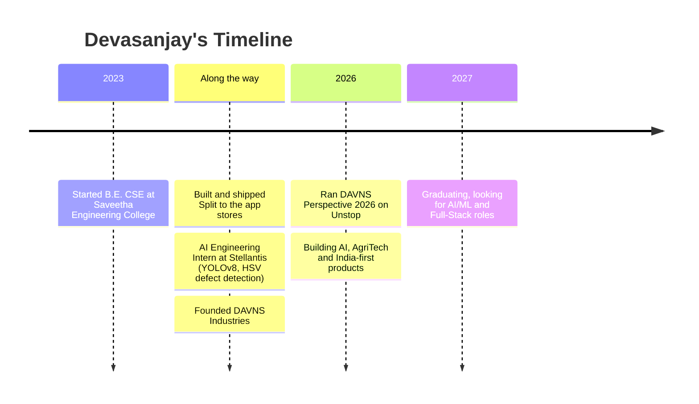

<!--
  PROFILE README for github.com/DEVASANJAY001
  Setup: create a PUBLIC repo named exactly "DEVASANJAY001" (same as your username),
  add this file as README.md in the root, and it appears on your profile automatically.

  Search this file for "TODO" to find the few links only you can fill in.
-->

<!-- ═══════════════════════ HEADER ═══════════════════════ -->

<div align="center">


<a href="https://github.com/DEVASANJAY001">
  
</a>

<br/>


<br/>

[](https://YOUR-PORTFOLIO-URL) <!-- TODO -->
[](https://www.linkedin.com/in/YOUR-LINKEDIN-ID) <!-- TODO -->
[](mailto:YOUR-EMAIL@example.com) <!-- TODO -->
[](https://YOUR-DAVNS-WEBSITE) <!-- TODO -->

</div>

---

<!-- ═══════════════════════ ABOUT ═══════════════════════ -->

## 👋 &nbsp;About Me

<table>
<tr>
<td width="62%" valign="top">

I'm **Devasanjay**, a final-year **B.E. Computer Science & Engineering** student at **Saveetha Engineering College (Anna University)**, based in **Chennai**, and the founder of **DAVNS Industries**.

I like building things end to end: a mobile app that real people download, a computer-vision model that catches defects on a factory line, or a full-stack platform designed around how India actually uses the internet.

- 🚀 **Founder** at **DAVNS Industries**, building and shipping products
- 📱 Shipped **Split**, a live expense-splitting app on the app stores
- 🏭 **AI Engineering Intern at Stellantis**, Thiruvallur Plant (automotive quality and vision systems)
- 🧠 Working across **LLM APIs, RAG and computer vision**
- 🇮🇳 Passionate about **India-focused tech problems** and underserved niches
- 🎓 Graduating in **2027**, open to **AI/ML, Full-Stack and Computer Vision** roles in Chennai

</td>
<td width="38%" valign="top" align="center">

```text
┌──────────────────────────────┐
│  🧑‍💻  DEVASANJAY N            │
├──────────────────────────────┤
│  Role   : Founder · Developer│
│  Org    : DAVNS Industries   │
│  Focus  : Full-Stack + AI/CV │
│  Edu    : B.E. CSE (2023-27) │
│  Base   : Chennai, India     │
│  Status : Building 🔨        │
│  Hiring?: Let's talk ✅      │
└──────────────────────────────┘
```

</td>
</tr>
</table>

---

<!-- ═══════════════════════ WHAT I DO ═══════════════════════ -->

## 🎯 &nbsp;What I Do

<div align="center">

| 📱 Mobile & Web Apps | 🤖 AI & LLM Systems | 👁️ Computer Vision | 🏗️ Product & Startups |
|:---:|:---:|:---:|:---:|
| React Native, React, Next.js apps with Firebase and Node backends, deployed to real users | LLM API integrations and Retrieval-Augmented Generation (RAG) pipelines | YOLOv8 object detection and HSV-based defect detection with OpenCV | Idea → spec → build → app store. Founder mindset, India-first thinking |

</div>

---

<!-- ═══════════════════════ TECH STACK ═══════════════════════ -->

## 🛠️ &nbsp;Tech Stack

<div align="center">

**Languages**


**Frontend & Mobile**


**Backend & Databases**


**AI / ML / Computer Vision**


**Tools & Workflow**


<br/>


</div>

---

<!-- ═══════════════════════ FEATURED WORK ═══════════════════════ -->

## 🚀 &nbsp;Featured Work

<table>
<tr>
<td width="50%" valign="top">

### 💸 Split
**Expense-splitting app · Live on the app stores**

A mobile app for splitting shared expenses among friends, built, deployed and maintained end to end.


[🔗 View on store](https://YOUR-SPLIT-APP-LINK) <!-- TODO -->

</td>
<td width="50%" valign="top">

### 🏭 Automotive Defect Detection
**AI Engineering Internship · Stellantis, Thiruvallur Plant**

Computer-vision based quality inspection using **YOLOv8** and **HSV colour-space defect detection**, applied to automotive plant use cases.


</td>
</tr>
<tr>
<td width="50%" valign="top">

### 🌾 AI Fertilizer Recommendation Engine
**Tamil Nadu hackathon project · In progress**

Designed to recommend optimal NPK fertilizer ratios per district, crop and season by combining soil-health data, crop-yield records and weather data (temperature, humidity, rainfall), modelled with **XGBoost** on STCR-based targets.


</td>
<td width="50%" valign="top">

### 🗣️ Adda
**Reddit-alternative platform for Indian users · Spec stage**

A social platform built around Indian users: a 200+ screen sitemap, mobile wireframes, AWS backend architecture, UPI-native monetisation and and a localisation strategy.


</td>
</tr>
<tr>
<td width="50%" valign="top">

### 🧠 DAVNS Perspective 2026
**"The Thinking Challenge" · College aptitude competition**

Organised by DAVNS Industries: a six-day aptitude competition for college students on Unstop (1–6 September 2026) with 180 quizzes.


</td>
<td width="50%" valign="top">

### 🔐 Encrypted Messaging Research
**Signal Protocol + Firebase architecture**

Explored end-to-end encrypted messaging architecture combining the Signal Protocol with Firebase for real-time delivery.


</td>
</tr>
</table>

> 📂 **248 repositories** live on this profile. Pinned repos below the README highlight my best work, and more is on the [Repositories tab](https://github.com/DEVASANJAY001?tab=repositories).

---

<!-- ═══════════════════════ EXPERIENCE ═══════════════════════ -->

## 💼 &nbsp;Journey



<details>
<summary><b>📋 Experience &amp; Education (click to expand)</b></summary>
<br/>

| Role | Where | What I did |
|:--|:--|:--|
| 🚀 **Founder** | DAVNS Industries | Builds and ships products, runs programs such as DAVNS Perspective 2026, owns product, engineering and brand |
| 🧪 **AI Engineering Intern** | Stellantis, Thiruvallur Plant | Computer-vision and AI work for automotive quality systems (YOLOv8, HSV-based defect detection) |
| 🎓 **B.E. Computer Science & Engineering** | Saveetha Engineering College, Anna University | 2023 – 2027 |

</details>

---

<!-- ═══════════════════════ CURRENTLY ═══════════════════════ -->

## 🔭 &nbsp;Right Now

| | |
|:--|:--|
| 🔨 **Building** | DAVNS Industries products, an AgriTech ML engine and the Adda platform spec |
| 📚 **Exploring** | RAG pipelines, LLM agents, encrypted messaging, YOLO-based inspection |
| 🌱 **Curious about** | India-specific problems: used-car verification in tier-2/3 cities, formalising domestic work, services for kirana stores |
| 🎯 **Looking for** | AI/ML Engineer · Full-Stack Developer · Computer Vision roles in Chennai (graduating 2027) |
| 💬 **Ask me about** | Shipping apps to the app stores, Firebase, YOLO + OpenCV, building a startup as a student |

---

<!-- ═══════════════════════ GITHUB STATS ═══════════════════════ -->

## 📊 &nbsp;GitHub Analytics

<div align="center">


<br/>


<br/>


<br/>


</div>

<!-- Optional: contribution snake. Add the workflow file from .github/workflows/snake.yml,
     run it once, then uncomment the block below.

<div align="center">
  <picture>
    <source media="(prefers-color-scheme: dark)" srcset="https://raw.githubusercontent.com/DEVASANJAY001/DEVASANJAY001/output/github-snake-dark.svg" />
    <source media="(prefers-color-scheme: light)" srcset="https://raw.githubusercontent.com/DEVASANJAY001/DEVASANJAY001/output/github-snake.svg" />
    
  </picture>
</div>
-->

---

<!-- ═══════════════════════ PHILOSOPHY ═══════════════════════ -->

## 🧭 &nbsp;How I Build

```python
class Devasanjay:
    role      = "Founder · Full-Stack Developer · AI Engineer"
    base      = "Chennai, India"
    stack     = ["Python", "JavaScript", "Java", "React / Next.js / React Native",
                 "Node / Express", "MongoDB / MySQL / Firebase",
                 "OpenCV", "YOLO", "LLM APIs", "RAG"]

    principles = [
        "Ship it, then improve it",
        "Build for real users, not demos",
        "Solve problems that are specific to India",
        "Specs first, code second, polish always",
    ]

    def currently(self):
        return "Building DAVNS Industries and looking for the next big challenge 🚀"
```

---

<!-- ═══════════════════════ CONNECT ═══════════════════════ -->

## 🤝 &nbsp;Let's Connect

<div align="center">

**Got a project, a role, or an idea worth building? I'd love to hear it.**

<br/>

<a href="https://www.linkedin.com/in/YOUR-LINKEDIN-ID"></a> <!-- TODO -->
<a href="mailto:YOUR-EMAIL@example.com"></a> <!-- TODO -->
<a href="https://YOUR-PORTFOLIO-URL"></a> <!-- TODO -->
<a href="https://github.com/DEVASANJAY001"></a>

<br/><br/>

<i>"Make it work, make it right, make it fast, then ship it."</i>

<br/>

⭐ From [DEVASANJAY001](https://github.com/DEVASANJAY001) with ☕ and 💻 in Chennai


</div>
